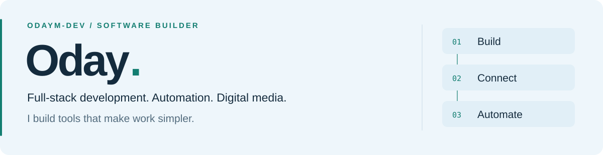

<picture>
  <source media="(prefers-color-scheme: dark)" srcset="./assets/profile-dark.svg">
  <source media="(prefers-color-scheme: light)" srcset="./assets/profile-light.svg">
  
</picture>

<strong>عُدي · برمجة، أتمتة، وإعلام رقمي</strong>

  <a href="#about">About</a> &nbsp;·&nbsp;
  <a href="#what-i-build">What I build</a> &nbsp;·&nbsp;
  <a href="#toolbox">Toolbox</a> &nbsp;·&nbsp;
  <a href="#selected-work">Selected work</a> &nbsp;·&nbsp;
  <a href="#بالعربية">بالعربية</a>

## About

I build **web applications, messaging bots, and automation systems** that simplify how people work. My background in digital media shapes how I design software: around real workflows, clear information, and practical results.

## What I build

<table>
  <tr>
    <td width="33%" valign="top">
      <h3>Web applications</h3>
      
Dashboards, service platforms, and back-end systems that connect ideas with everyday use.

    </td>
    <td width="33%" valign="top">
      <h3>Bots &amp; automation</h3>
      
Telegram and WhatsApp bots, API integrations, and workflows that reduce repetitive work.

    </td>
    <td width="33%" valign="top">
      <h3>Digital media tools</h3>
      
Publishing, monitoring, and content-production tools built around the way media teams work.

    </td>
  </tr>
</table>

## Toolbox

| Area | Technologies |
| :--- | :--- |
| Languages | `PHP` · `JavaScript` · `TypeScript` · `Python` |
| Applications | `Node.js` · `Express` · `Next.js` · `Flask` |
| Data & infrastructure | `MySQL` · `Redis` · `Docker` · `Linux` · `Nginx` |
| Integrations | `Telegram Bot API` · `WhatsApp` · `n8n` |

## Selected work

### [Session Limit](https://github.com/OdayM-Dev/session-limit)

A Windows desktop companion for keeping track of **Claude Code and Codex usage limits**. A floating ring, live activity indicators, and timely alerts keep usage visible while you work.

**Python + TypeScript** &nbsp;·&nbsp; **Arabic & English** &nbsp;·&nbsp; **MIT license**

[Explore the project →](https://github.com/OdayM-Dev/session-limit)

---

<h2 id="بالعربية">بالعربية</h2>

أطوّر تطبيقات ويب وبوتات وأنظمة أتمتة، وأجمع بين البرمجة والإعلام الرقمي لبناء أدوات تسهّل العمل وتحوّل الأفكار إلى حلول قابلة للاستخدام.

Less repetitive work. More useful software.

